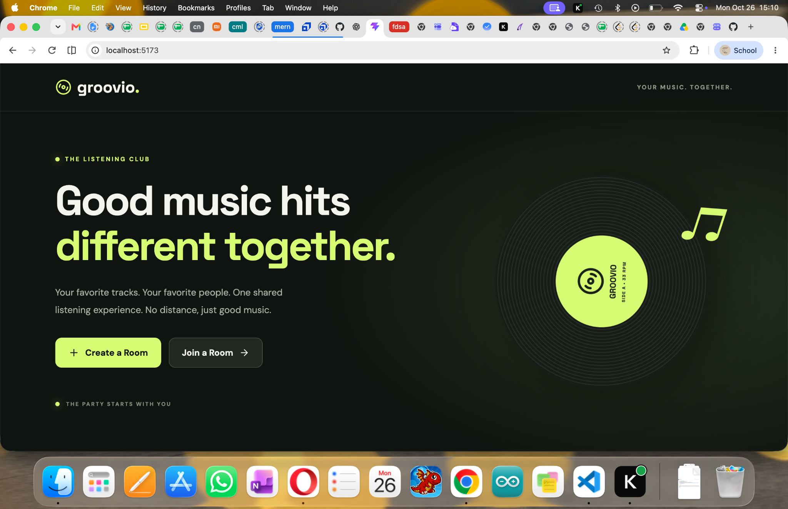
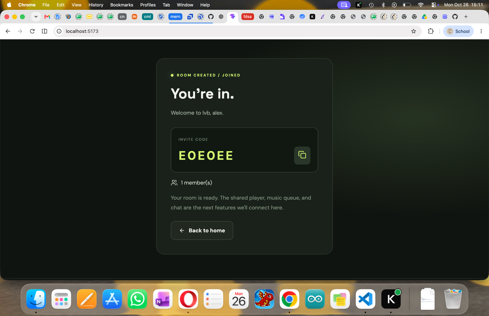
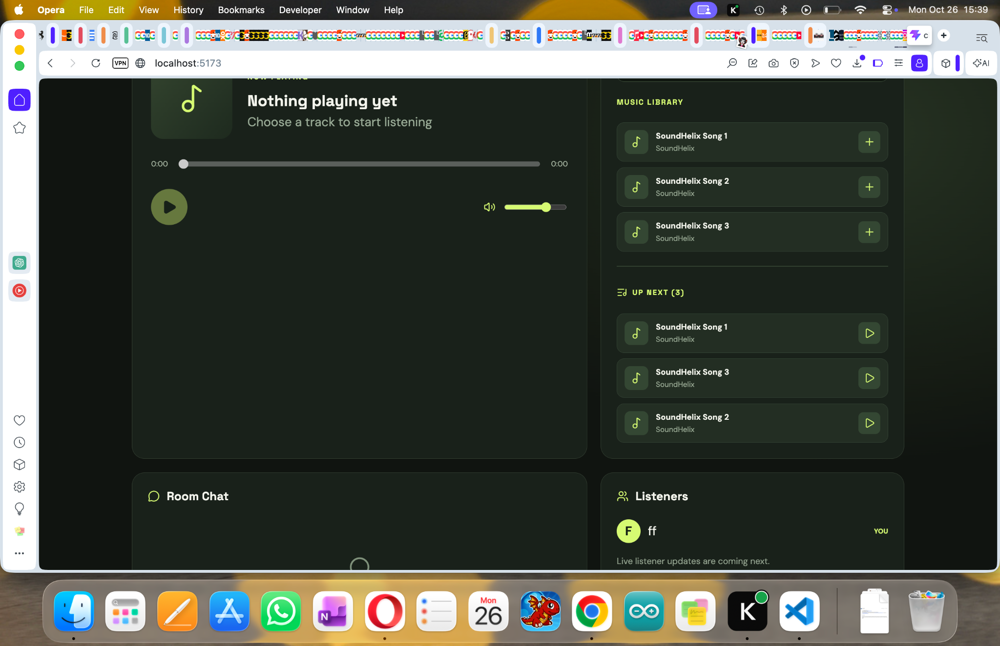
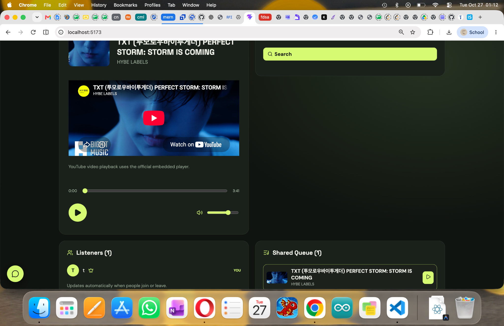
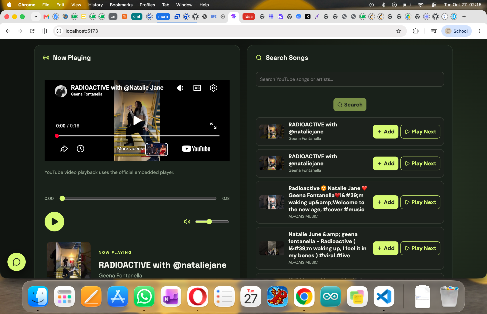
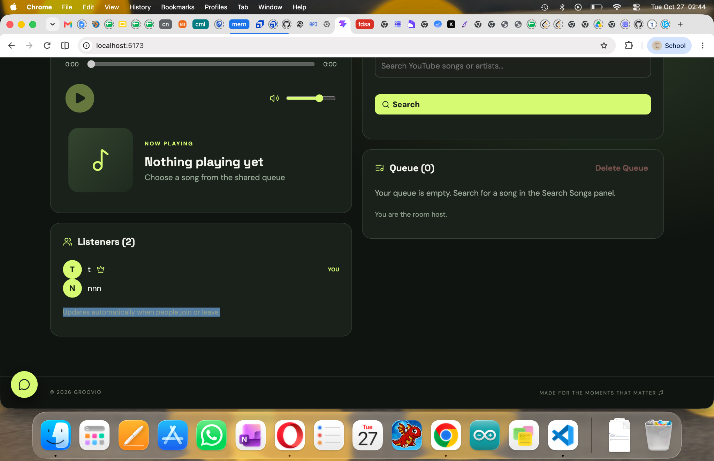

# 🎧 Groovio

**Your music. Together.**

[**Live App**](https://groovio-seven.vercel.app/) · [**Backend**](https://groovio-backend.onrender.com) · [**Source Code**](https://github.com/HTG08/groovio)

Groovio is a full-stack collaborative music-room application built with the MERN stack and Socket.IO. Friends can join the same room, discover YouTube music, manage a shared queue, chat, and control playback together.

> **Status:** Deployed and functional. Some YouTube seeking and replay synchronization edge cases are still being improved. The free Render backend may take time to wake up after inactivity.

## The Problem, Solution, and Users

**Problem:** Friends listening remotely often have to coordinate songs, queues, and playback manually across separate devices. Sending links back and forth makes shared listening awkward.

**Solution:** Groovio provides a single shared listening room with a room code, synchronized playback state, collaborative queue, real-time chat, and host-controlled permissions.

**Target users:** Friends, remote groups, and music enthusiasts who want to listen together without creating traditional accounts.

### Main User Workflows

1. **Create a room:** Enter a display name and room name to generate a shareable six-character code.
2. **Join a room:** Enter a room code and display name to join friends.
3. **Find and queue music:** Search YouTube, add a video to the shared queue, or use **Play Next**.
4. **Listen together:** Play, pause, select, and seek tracks; room playback updates are shared over Socket.IO.
5. **Collaborate:** Chat with listeners and use **Host Only** to restrict or allow shared controls.

## Screenshots

Screenshots were taken during development; the latest interface may differ slightly.

### Landing page


### Join a room


### Early prototype with bundled test tracks


### Embedded YouTube player


### YouTube search and shared queue


### Listeners and chat


## Features

- Unique room codes, room membership, and host/member roles
- YouTube search using the YouTube Data API v3 and playback through the YouTube IFrame Player API
- Shared queue, **Play Next**, and queue clearing
- Host Only permission toggle for playback and queue controls
- Real-time chat, listener presence, queue updates, and playback events using Socket.IO
- Room-specific JWT authorization for protected actions
- MongoDB-backed rooms, queue, permissions, and playback state
- Responsive web interface, with further mobile refinements planned

## Tech Stack

| Layer | Technologies |
| --- | --- |
| Frontend | React, Vite, JavaScript, CSS |
| Backend | Node.js, Express.js |
| Database | MongoDB Atlas, Mongoose |
| Real-time communication | Socket.IO |
| Authorization | JSON Web Tokens (JWT) |
| Music | YouTube Data API v3, YouTube IFrame Player API |
| Hosting | Vercel (frontend), Render (backend) |

## Architecture and Data Flow

```text
Browser A (React)                     Browser B (React)
      |                                     |
      +--------- HTTPS / Socket.IO --------+
                         |
                 Express + Socket.IO
                  /             \
          MongoDB Atlas      YouTube Data API
        (room and queue)    (search and metadata)
                         |
             YouTube IFrame Player
             (embedded in each browser)
```

**Example: Add a song to the queue**

1. A member searches YouTube from the React interface.
2. The Express backend calls the YouTube Data API and validates video metadata.
3. The member adds a selected video to the room queue through a protected REST endpoint.
4. The backend verifies room membership and the room's Host Only setting, then updates MongoDB.
5. Socket.IO broadcasts the updated queue to connected listeners.
6. Playback commands update shared room state and are broadcast to other members.

The backend remains responsible for permissions and shared state; the React interface is not trusted to enforce authorization by itself.

## Why Room-Based JWT Authentication?

Groovio is designed for quick, temporary, code-based listening sessions, so users do not need to register permanent accounts. Creating or joining a room establishes a room-specific identity and JWT. Protected backend actions validate that identity and check host/member permissions. This is a deliberate product decision, not a traditional email/password authentication system.

## Project Structure

```text
groovio/
├── client/
│   ├── public/music/       # Original MP3 test tracks
│   ├── src/
│   │   ├── components/     # Player and room UI
│   │   ├── pages/          # Room screens
│   │   └── services/       # Socket.IO client
│   └── package.json
├── server/
│   ├── controllers/        # Room and YouTube logic
│   ├── models/             # Mongoose room model
│   ├── routes/             # REST endpoints
│   ├── utils/              # JWT room helpers
│   ├── index.js            # Express and Socket.IO
│   └── package.json
├── screenshots/
└── README.md
```

## Run Locally

**Prerequisites:** Node.js, npm, MongoDB Atlas connection string, and a YouTube Data API v3 key.

```bash
git clone https://github.com/HTG08/groovio.git
cd groovio/server
npm install
```

Create `server/.env`:

```env
PORT=8888
MONGO_URI=your_mongodb_connection_string
JWT_SECRET=your_long_random_secret
YOUTUBE_API_KEY=your_youtube_api_key
CLIENT_URL=http://localhost:5173
```

Start the backend:

```bash
npm start
```

In another terminal:

```bash
cd groovio/client
npm install
```

Create `client/.env`:

```env
VITE_SERVER_URL=http://localhost:8888
```

Then start Vite:

```bash
npm run dev
```

Open the URL Vite prints, typically `http://localhost:5173`. If running commands from the repository root instead, use `cd client` to enter the frontend folder. **Never commit real `.env` files or API credentials.**

## REST API Overview

| Method | Endpoint | Purpose |
| --- | --- | --- |
| `POST` | `/api/rooms/create` | Create a listening room |
| `POST` | `/api/rooms/join` | Join by room code |
| `GET` | `/api/rooms/:code` | Retrieve room state |
| `GET` | `/api/rooms/youtube/search` | Search YouTube |
| `POST` | `/api/rooms/:code/queue` | Add song / Play Next |
| `DELETE` | `/api/rooms/:code/queue` | Clear queue |
| `PATCH` | `/api/rooms/:code/permissions` | Update Host Only setting |

## Security and Validation

- Protected actions use room-specific JWT validation and backend permission checks.
- The backend checks room membership and host-only restrictions before modifying shared state.
- YouTube video IDs and metadata are validated server-side before queuing.
- MongoDB connection strings, JWT secrets, and YouTube API credentials are stored in backend environment variables.
- Playback uses YouTube's official embedded player, not audio downloading.

## Testing and Known Limitations

**Observed working in deployment:** Room creation, real-time chat, YouTube music playback in host mode, and core room UI.

**Remaining issues to address:**

- Custom seek bar and YouTube's native seek bar can lag behind each other.
- Replaying a video after it ends can be unreliable.
- Chat history is held in server memory and can be lost when the backend restarts.
- Free Render instances can spin down when idle, delaying the first connection.
- Additional testing is needed for reconnection, mobile layouts, and network/API failures.

## Development Notes and Test Audio

Before YouTube integration, Groovio used three bundled sample MP3 files:

| Track | Location |
| --- | --- |
| SoundHelix Song 1 | `client/public/music/track1.mp3` |
| SoundHelix Song 2 | `client/public/music/track2.mp3` |
| SoundHelix Song 3 | `client/public/music/track3.mp3` |

These are development/demo assets, not Groovio's main music catalog. Verify the original source's license and attribution requirements before redistribution.

During development, queue-clearing behavior, Host Only permissions, Play Next insertion, and the atomic `select-and-play` action were refined to improve consistency.

## Future Improvements

- Improve seeking and end-of-video synchronization
- Persist chat history in MongoDB
- Improve reconnection handling and mobile responsiveness
- Add saved playlists and more room management options

## Author

Developed by [HTG08](https://github.com/HTG08) as a full-stack web development and real-time collaboration project.
